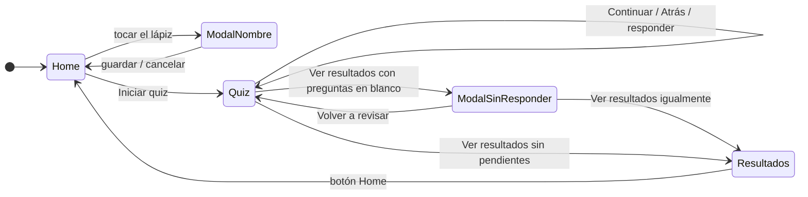
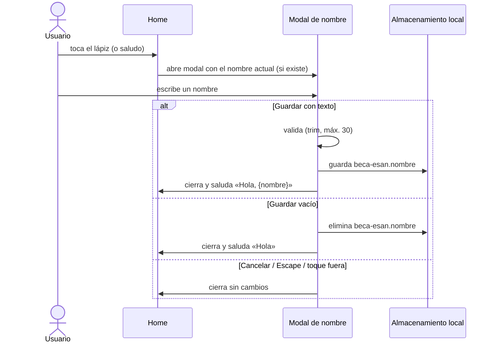
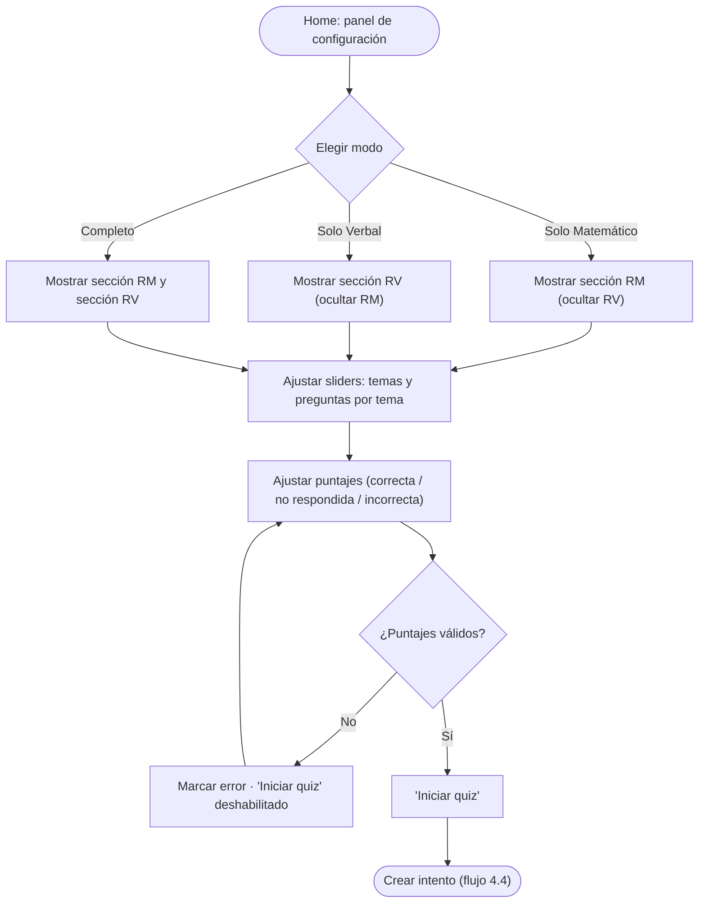
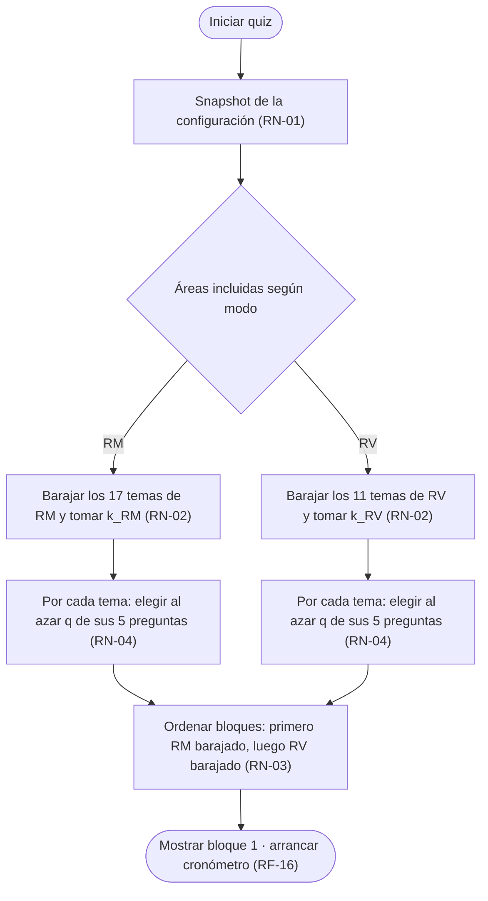
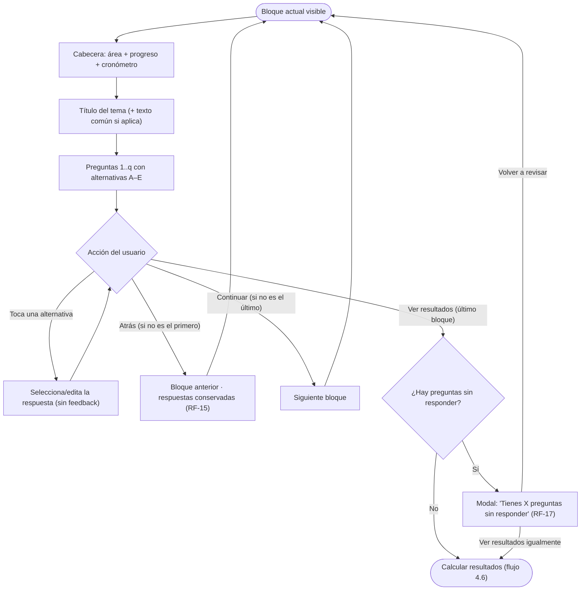
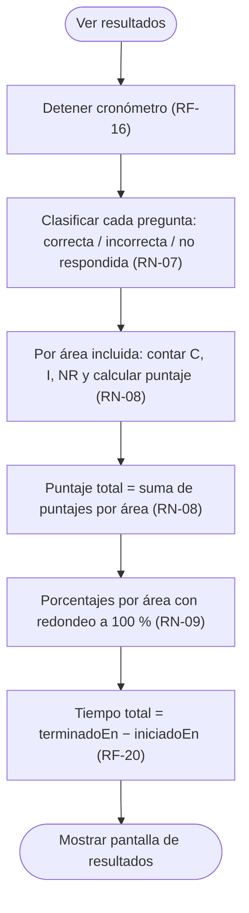
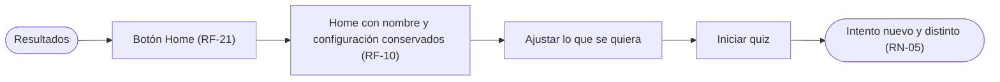

# 04 — Flujos

Diagramas de flujo y de navegación de la aplicación. Los identificadores **RF-xx / RN-xx** refieren a `02-requerimientos-funcionales.md`; el modelo de datos, a `03-modelo-de-datos.md`.

## 4.1 Navegación global

Reglas de navegación:

- **Home** es el punto de entrada y de retorno: saludo + panel de configuración (RF-01 a RF-11).
- El **quiz** solo se abandona de dos formas: ver resultados o recargar/cerrar la página (se pierde el intento; aviso previo si es posible, RF-18).
- **Resultados** no tiene navegación hacia atrás: solo el botón **Home** (RF-21).
- Al volver a Home se **conserva** la configuración del intento anterior (RF-10) y el nombre (RF-02).

## 4.2 Flujo del nombre (Home)

Notas: en escritorio el lápiz muestra el tooltip «Pon aquí tu nombre» al hover/focus (RF-01.2); en táctil, el toque abre la modal directamente.

## 4.3 Flujo de configuración e inicio del quiz (Home)

Notas: los sliders de temas del área oculta conservan su valor (RF-03); el resumen estimado se recalcula en vivo (RF-08); el botón «Iniciar quiz» es sticky en móvil (RF-09).

## 4.4 Flujo de generación del intento (al pulsar «Iniciar quiz»)

Ejemplo verificado con el material actual: modo Completo, RM 10 temas y RV 5 temas, q = 3 → 15 bloques, 45 preguntas; 10 temas distintos de 17 y 5 distintos de 11; 3 preguntas distintas por tema.

## 4.5 Flujo del quiz (por bloques)

Notas:

- El cronómetro corre de forma continua entre bloques (RF-16).
- ir «Atrás» no borra nada: las respuestas del bloque actual ya están registradas (RF-15).
- La confirmación de RF-17 solo aparece en el último bloque, al pulsar «Ver resultados».

## 4.6 Flujo de cálculo de resultados

## 4.7 Flujo de resultados a un nuevo intento

Notas: no hay historial; el intento anterior se descarta al iniciar el siguiente. El usuario puede repetir con la misma configuración y aun así recibir temas y preguntas diferentes (si el azar lo permite).
